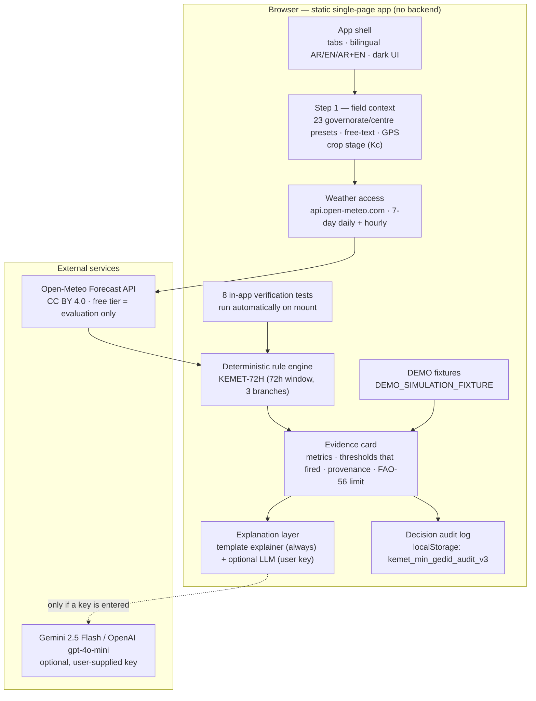
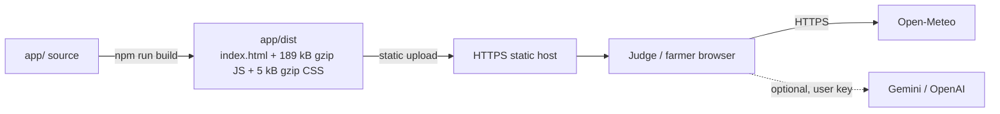

# System Architecture and Technical Documentation
## كيمت من جديد — Kemet Min Gedid · prototype `app/`

**Version:** v3 (React build) · **Rule:** `KEMET-72H` · **Track:** SolveThe17 — SDG 13
**Status:** working prototype. Everything below describes code that exists in `app/` and was executed on 23 October 2026 (production build + a headless-browser run).

---

## 1. Component view



There is no server component: the build output is HTML + one JS bundle + one CSS file. That decision keeps the deployment free and the farmer data on the device, and it is the reason the optional AI call has to be made from the browser (see §7).

---

## 2. Technical stack

| Layer | Choice | Why |
|---|---|---|
| UI | React 18 (single `App.tsx` module, ~3.4 k lines) | one artifact, easy to review end-to-end |
| Styling | Tailwind CSS 3 | no bespoke design system needed in a hackathon |
| Charts | Recharts 2 (`ComposedChart`, `Bar`, `Line`, `ReferenceLine`) | thresholds are drawn as reference lines, not decoration |
| Icons | lucide-react | bundled locally, no icon font request |
| Build | Vite 5 + `@vitejs/plugin-react` 4.3.4 | static output, no runtime dependency |
| Persistence | `localStorage` (one key) | no account, no backend, no PII |
| Language | TypeScript (`.tsx`) transpiled by Vite | typed evidence-card object |

---

## 3. Data contract (Open-Meteo)

Request (one per location/refresh):

```
GET https://api.open-meteo.com/v1/forecast
  ?latitude=<lat>&longitude=<lon>
  &daily=temperature_2m_max,temperature_2m_min,precipitation_sum,
         precipitation_probability_max,wind_speed_10m_max,et0_fao_evapotranspiration
  &hourly=temperature_2m,relative_humidity_2m,precipitation_probability,
          wind_speed_10m,et0_fao_evapotranspiration
  &timezone=Africa/Cairo
  &forecast_days=7
```

* Times are **service-local wall-clock strings** for `Africa/Cairo`; the app never re-interprets them as UTC.
* Measured response size: **7.6 kB** (daily + hourly, 7 days); **0.85 kB** if only daily fields are requested.
* The app measures the round trip itself and displays it (`Fetched HH:MM:SS · NNN ms · HTTP 200`) so a judge can see the request was real.

**Failure handling:** a non-2xx response or a payload missing the daily arrays ⇒ no evidence card is produced from it; the app shows the error state and offers the DEMO fixtures instead. `DEMO / SIMULATION` data carries `provenance: 'DEMO_SIMULATION_FIXTURE'` and is never merged into the live path (asserted by in-app test TEST-06).

---

## 4. Rule engine

`evaluateDeterministicPlanningRule(dailyData, cropStage, provenance, locationLabel)` — a single pure function over the first **3 days (72 h)** of the daily arrays:

| Step | Computation |
|---|---|
| Window slice | `tMax72 = max(tmax[0..2])`, `tMin72 = min(tmin[0..2])`, `rainSum72 = Σ rain[0..2]` (2 dp), `rainProbMax72 = max(prob[0..2])`, `windMax72 = max(wind[0..2])` (1 dp), `et0Max72 = max(eto[0..2])`, `et0Mean72` |
| Indicative crop demand | `ETc_peak = Kc × et0Max72`, `ETc_mean = Kc × et0Mean72` (FAO-56 shape; Kc per crop stage) |
| Check A (rain) | `rainSum72 ≥ 5.0` **or** `rainProbMax72 ≥ 60` → HOLD / verify drainage |
| Check B (heat, demand, wind) | not A, and `tMax72 ≥ 35.0` **or** `et0Max72 ≥ 6.5` **or** `windMax72 ≥ 30` |
| Check C | otherwise → routine 72 h window |
| Output | `checkCode`, level, severity colour, bilingual status title, bilingual action steps, metrics object, limitation strings |

Full threshold rationale, non-uses and change control: `docs/RULE-REGISTER.md`. The function returns `null` when fewer than 3 daily values exist — a missing window is never reported as “all clear”.

---

## 5. Evidence card (the product’s actual differentiator)

Every card carries, in both languages:

1. `ruleId` + `checkCode` (which branch fired) and the threshold that triggered it.
2. The full 72-hour metric set (max/min temperature, rain sum and probability, wind, ETo, indicative ETc and the Kc used).
3. **Provenance** — `LIVE_OPEN_METEO_API` or `DEMO_SIMULATION_FIXTURE`, shown as a chip and repeated in the raw-JSON inspector.
4. The mandatory FAO-56 limitation: this is a 72-hour meteorological planning check, **not** an irrigation volume prescription; real scheduling needs hand-checked root-zone moisture, salinity/drainage, and the local canal rotation (مناوبة الترعة).
5. The action steps for that branch, and the farmer’s recorded decision (audit log).

---

## 6. Optional explanation layer

| Path | Trigger | Behaviour |
|---|---|---|
| Template explainer | always available | bilingual, built only from the evidence-card numbers; labelled as a constrained explainer |
| Live LLM | user enters a Gemini or OpenAI key in the settings modal | system prompt forbids inventing numbers, overriding the deterministic rule, or citing m³/feddan; on any error the app falls back to the template explainer and says so |
| No AI at all | default | the whole workflow (rule → card → audit log) runs untouched; the AI is never in the decision path |

Model default `gemini-2.5-flash`, alternative `gpt-4o-mini`. Latency and an estimated token cost are displayed with each response.

---

## 7. Security and privacy posture — honest version

| Item | Current state | Assessment |
|---|---|---|
| Project secrets in the bundle | none | good — nothing to leak |
| AI key | typed by the user into the page, held in component state, sent from the browser to the provider | **weak by design.** Nothing is persisted, but any injected script or extension can read the key while it is in memory. Acceptable only because the key is the user’s own and no project credential exists; a pilot must move this call behind a server-side proxy |
| Farmer data sent to the AI | the evidence-card JSON (location label, weather metrics, crop stage) | must be disclosed to the user; contains no personal identifiers, but it is location data |
| Audit log | `localStorage`, device-local, up to the browser’s quota | no server, no account, no cross-device sync — and no deletion UI yet |
| Incoming request validation | not applicable (no backend) | there is no server endpoint to validate; the client validates provider payloads instead |
| XSS surface | React text interpolation; one raw-JSON inspector rendered from the evidence object | low, but the JSON inspector should be reviewed before any user-supplied strings reach it |

---

## 8. Deployment



Current public demo: **https://walnut-diner-m3as.here.now/** (static build of `app/`, verified reachable over HTTPS).

---

## 9. Verification performed on this build (23 Oct 2026)

| Check | Result |
|---|---|
| Production build | ✓ 2 746 modules, built in 8.10 s, `BUILD_EXIT=0` |
| Bundle weight | 671.72 kB JS (**189.45 kB gzip**) + 24.83 kB CSS (5.07 kB gzip) |
| Headless Chrome 155 run at 390 × 844 | app booted, **0 console errors, 0 failed requests**, live Open-Meteo call `HTTP 200` in 1 343 ms |
| In-app verification suite | 8/8 assertions pass on mount (rule branches C and A fixtures, LIVE/DEMO isolation, FAO-56 disclaimer presence, AI-off independence, unit-economics constants) |
| Arabic RTL / bilingual switching | AR, EN and AR+EN modes render; RTL text direction correct |
| Narrow mobile (360 px) | **fails**: `scrollWidth 382` vs `clientWidth 360` → 22 px horizontal overflow (open defect) |

## 10. Repository map

```
app/src/App.tsx      the whole application (UI, data access, rule engine, explainer, audit log, self-tests)
app/src/main.tsx     React entry point
app/index.html       document shell
app/vite.config.ts   build config (single plugin: react)
docs/                this document, the rule register, the field deployment brief, the EGP BOM
```
